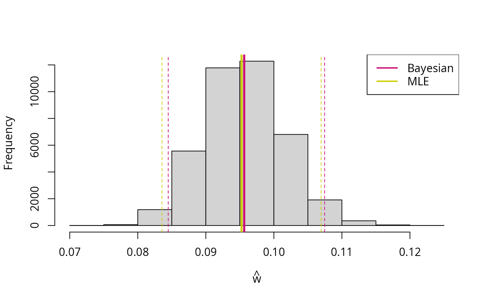

# Introduction

``` r

library(wgsLR)
```

## Estimating the genotype error probability, $`w`$

A simple example:

``` r

cases <- sample_data_Hp_w(n = 1000, w = 0.1, p = c(0.25, 0.25, 0.5))
tab <- table(cases$xT, cases$xR)
tab
#>    
#>       0   1   2
#>   0 180  53   7
#>   1  55 193  99
#>   2   8  78 327
```

### Maximum likelihood estimation

``` r

w_mle <- wgsLR::estimate_w(tab)
w_mle
#> [1] 0.0952511
w_mle_se <- wgsLR::estimate_w_se(tab, w_mle)
w_mle_se
#> [1] 0.005846343
```

The last lines estimate the standard error that will be used below to
construct an approximate confidence interval.

*Please be aware of the “Cautionary note” in the README (about not just
using standard VCF-files).*

### Bayesian inference

The package contains a simple Metropolis-Hastings sampler (also see the
“Using Stan for Bayesian inference” vignette):

``` r

w_b <- wgsLR::estimate_w_bayesian(tab) |> posterior_samples()
w_b_q <- quantile(w_b, c(0.025, 0.975))
```

``` r

hist(w_b, main = NULL, xlab = expression(hat(w)))
abline(v = mean(w_b), col = "deeppink3", lwd = 3)
abline(v = w_b_q[1], col = "deeppink3", lty = 2)
abline(v = w_b_q[2], col = "deeppink3", lty = 2)
abline(v = w_mle, col = "yellow3", lwd = 3)
abline(v = w_mle - 2*w_mle_se, col = "yellow3", lty = 2)
abline(v = w_mle + 2*w_mle_se, col = "yellow3", lty = 2)
legend("topright", col = c("deeppink3", "yellow3"), legend = c("Bayesian", "MLE"), lty = 1, lwd = 2)
```



The dashed lines indicate approximate confidence intervals (maximum
likelihood estimation) and credible interval (Bayesian inference).

*Please be aware of the “Cautionary note” in the README (about not just
using standard VCF-files).*

## Calculating likelihood ratios ($`LR`$’s)

No errors and matching genotypes:

``` r

LR_contribs <- wgsLR::calc_LRs_w(xT = c(0, 0), 
                                 xR = c(0, 0), 
                                 w = 0, 
                                 p = c(0.25, 0.25, 0.5))
prod(LR_contribs)
#> [1] 16
```

No errors and non-matching genotypes:

``` r

LR_contribs <- wgsLR::calc_LRs_w(xT = c(1, 0), 
                                 xR = c(0, 0), 
                                 w = 0, 
                                 p = c(0.25, 0.25, 0.5))
prod(LR_contribs)
#> [1] 0
```

Errors possible and matching genotypes:

``` r

LR_contribs <- wgsLR::calc_LRs_w(xT = c(0, 0), 
                                 xR = c(0, 0), 
                                 w = 0.001, 
                                 p = c(0.25, 0.25, 0.5))
prod(LR_contribs)
#> [1] 15.936
```

Errors possible and non-matching genotypes:

``` r

LR_contribs <- wgsLR::calc_LRs_w(xT = c(1, 0), 
                                 xR = c(0, 0), 
                                 w = 0.001, 
                                 p = c(0.25, 0.25, 0.5))
prod(LR_contribs)
#> [1] 0.04761785
```

### Different error rates

Assume that the trace donor profile has $`w_t = 10^{-4}`$ and the
suspect reference profile has $`w_r = 10^{-8}`$. Then the $`LR`$ is:

``` r

LR_contribs <- wgsLR::calc_LRs_wTwR(xT = c(1, 0), 
                                    xR = c(0, 0), 
                                    wT = 1e-4, 
                                    wR = 1e-8,
                                    p = c(0.25, 0.25, 0.5))
prod(LR_contribs)
#> [1] 0.003198241
```

### Unknown trac sample error rate, $`w_T`$

Assume that the trace donor profile has unknown $`w_T`$ but can be
assumed to follow a beta prior on $`(0, \frac 1 2)`$ with mean value
$`\mu = 10^{-4}`$ and variance $`\sigma^2 = \mu^2 / 2`$:

``` r

mu <- 1e-4
sigmasq <- mu^2 / 2
shpT <-wgsLR::get_beta_parameters(mu = mu, sigmasq = sigmasq, a = 0, b = 0.5)
# 90% probability:
q <- wgsLR::qbeta05(c(0.05, 0.95), shape1 = shpT[1], shape2 = shpT[2])
q
#> [1] 1.776372e-05 2.371951e-04
curve(wgsLR::dbeta05(x, shpT[1], shpT[2]), from = 0, to = 1e-3, n = 1001)
abline(v = mu, lty = 2)
abline(v = q, lty = 3)
```


Further, assume that the suspect reference profile has
$`w_R = 10^{-8}`$. Then the $`WoE = \log_{10}(LR)`$ is:

``` r

wgsLR::calc_WoE_wTwR_integrate_wT_mc(
  xT = c(1, 0, 2, 2), 
  xR = c(0, 0, 2, 2), 
  shape1T_Hp = shpT[1], shape2T_Hp = shpT[2],
  shape1T_Ha = shpT[1], shape2T_Ha = shpT[2],
  wR = 1e-8,
  p = c(0.25, 0.25, 0.5))
#> [1] -1.891458
```

## Verifying formulas

The usual $`LR`$ values, $`\frac{1}{p_{Z^S}}`$ for matches and $`0`$ for
non-matches, are obtained when setting $`w = 0`$. For example with both
packages `wgsLR` and `caracas` loaded we can do the following:

``` r

library(caracas)
LR <- d_LR_w$expr
LRw0 <- sapply(LR, \(x) as_sym(x) |> subs("w", 0) |> as_character())
with(d_LR_w, cbind(xT, xR, LRw0))
#>       xT  xR  LRw0   
#>  [1,] "0" "0" "1/p_0"
#>  [2,] "0" "1" "0"    
#>  [3,] "0" "2" "0"    
#>  [4,] "1" "0" "0"    
#>  [5,] "1" "1" "1/p_1"
#>  [6,] "1" "2" "0"    
#>  [7,] "2" "0" "0"    
#>  [8,] "2" "1" "0"    
#>  [9,] "2" "2" "1/p_2"
```

And with sample specific error rates, $`w_D`$ and $`w_S`$:

``` r

library(caracas)
LR <- d_LR_wTwR$expr
LRw0 <- sapply(LR, \(x) as_sym(x) |> 
                 subs("wT", 0) |> 
                 subs("wR", 0) |> as_character())
with(d_LR_wTwR, cbind(xT, xR, LRw0))
#>       xT  xR  LRw0   
#>  [1,] "0" "0" "1/p_0"
#>  [2,] "0" "1" "0"    
#>  [3,] "0" "2" "0"    
#>  [4,] "1" "0" "0"    
#>  [5,] "1" "1" "1/p_1"
#>  [6,] "1" "2" "0"    
#>  [7,] "2" "0" "0"    
#>  [8,] "2" "1" "0"    
#>  [9,] "2" "2" "1/p_2"
```
