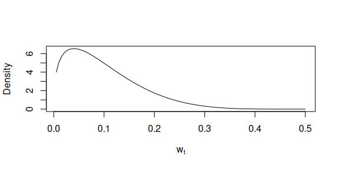
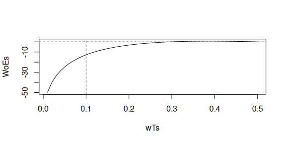
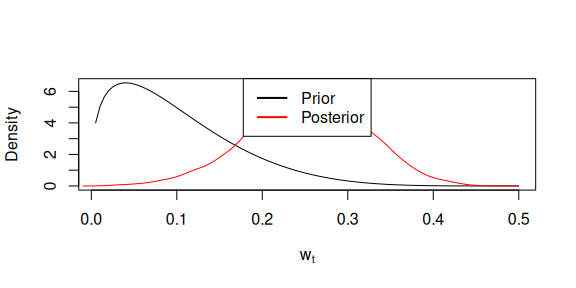
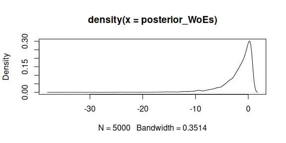

# Posterior likelihood ratio distributions

``` r

library(wgsLR)
#> Loading required package: pracma
#> Loading required package: DEoptim
#> Loading required package: parallel
#> 
#> DEoptim package
#> Differential Evolution algorithm in R
#> Authors: D. Ardia, K. Mullen, B. Peterson and J. Ulrich
```

The following is based on Section 3 in Meester and Slooten (2021).

Assuming everything except trace sample error rate, $`w_t`$, is known
(i.e. reference sample error rate $`w_r`$ and genotype probabilities
$`p_0`$, $`p_1`$, and $`p_2`$), then

``` math
\begin{align}
    LR(E) &= \frac{\int P(E \mid w_t, H_p) f(w_t \mid H_p) d w_t}{\int P(E \mid w_t, H_a) f(w_t \mid H_a) d w_t} .
\end{align}
```

Assuming in the rest of this document that the prior of $`w_t`$ under
$`H_p`$ and $`H_a`$ coincide such that
$`f(w_t \mid H_p) = f(w_t \mid H_a)`$ then

``` math
\begin{equation}
    LR(E) = \int LR_{w_t}(E) \, f(w_t \mid E, H_a) \, d w_t ,
\end{equation}
```
where
``` math
\begin{align}
    LR_{w_t}(E) &= \frac{P(E \mid w_t, H_p)}{P(E \mid w_t, H_a)} .
\end{align}
```

Thus,
``` math
\begin{equation}
    LR(E) = E_{w_t \mid E, H_a} \left [ LR_{w_t}(E) \right ] .
\end{equation}
```

So if we can sample from $`w_t \mid E, H_a`$ and calculate the $`LR`$’s
as if $`w_t`$ was known, we get the posterior likelihood ratio
distribution under $`H_a`$.

There are some interesting points in Meester and Slooten (2021) that are
quoted below. Quotation marks were not used as $`\theta`$ was replaced
by $`w_t`$ and $`H_2`$ by $`H_a`$ and points about the posterior
likelihood ratio distribution under $`H_p`$ was removed:

- Thus, sampling from the posterior likelihood ratio distribution under
  $`H_a`$ tells us what likelihood ratios we expect to obtain if we can
  eliminate our uncertainty about $`w_t`$, but we do not expect the
  likelihood ratio to change in either direction.

- When we repeatedly sample $`LR_{w_t}(E)`$ using
  $`f(w_t \mid E, H_a)`$, we can, by disregarding the, say, 5% most
  extreme outcomes, construct an interval. This interval tells us
  something about the values of future likelihood ratios that we would
  obtain, were we to remove all existing uncertainty about the model
  parameters $`w_t`$.

### Example

``` r

set.seed(2026)
m <- 100
q <- runif(m, min = 0.2, max = 0.8)
p <- lapply(q, \(q0) c(q0^2, 2*q0*(1-q0), (1-q0)^2))
wR <- 1/100
cases <- sample_data_Ha_wTwR(n = m, wT = 1/10, wR = wR, p = p)
xT <- cases$xT[, 1L]
xR <- cases$xR[, 1L]
table(xT, xR)
#>    xR
#> xT   0  1  2
#>   0 11 17  1
#>   1 20 28  7
#>   2  4  9  3
```

We can calculate $`LR`$’s, or rather $`WoE = \log_{10}(LR)`$:

``` r

WoE_full_knowledge <- calc_LRs_wTwR(
  xT = xT, 
  xR = xR, 
  wR = wR, 
  wT = 1/10,
  p = p
) |> 
  log10() |> 
  sum()
WoE_full_knowledge
#> [1] -12.75511
```

``` r

shps <- get_beta_parameters(mu = 1/10, sigmasq = (1/10)^2/2)
shps
#> [1] 1.4 5.6
qbeta05(c(0.025, 0.975), shape1 = shps[1], shape2 = shps[2])
#> [1] 0.007436954 0.269891865
```

``` r

prior_x <- seq(0, 0.5, length.out = 100)[-1]
prior_y <- dbeta05(prior_x, shape1 = shps[1], shape2 = shps[2])
plot(prior_y ~ prior_x, type = "l", xlab = expression(w[t]), ylab = "Density")
```



``` r

WoE_marginalisation <- calc_WoE_wTwR_integrate_wT_mc(
  xT = xT, 
  xR = xR, 
  wR = wR, 
  p = p,
  shape1T_Hp = shps[1], 
  shape2T_Hp = shps[2],
  shape1T_Ha = shps[1], 
  shape2T_Ha = shps[2]
)
WoE_marginalisation
#> [1] 0.1494583
```

``` r

wTs <- seq(1/100, 1/2, length.out = 50)
WoEs <- lapply(wTs, \(wT) {
  calc_LRs_wTwR(
    xT = xT, 
    xR = xR, 
    wR = wR, 
    wT = wT,
    p = p
  ) |> 
    log10() |> 
    sum()
}) |> unlist()
plot(wTs, WoEs, type = "l")
abline(h = 0, lty = 2)
abline(v = 1/10, lty = 2)
```



``` r

m <- wT_posterior_Ha_stan(xT = xT, xR = xR, wR = wR, p = p,
                          prior_a = shps[1], 
                          prior_b = shps[2],
                          chains = 5,
                          parallel_chains = 5,
                          iter_warmup = 100,
                          iter_sampling = 1000)
wT_Ha_E <- m$draws("wT") |> c()
```

``` r

plot(prior_y ~ prior_x, type = "l", xlab = expression(w[t]), ylab = "Density")
lines(density(wT_Ha_E), col = "red")
legend("topright", c("Prior", "Posterior"), col = c("black", "red"), lty = 1, lwd = 2)
```



``` r

posterior_WoEs <- lapply(wT_Ha_E, \(wT) {
  calc_LRs_wTwR(
    xT = xT, 
    xR = xR, 
    wR = wR, 
    wT = wT,
    p = p
  ) |> 
    log10() |> 
    sum()
}) |> unlist()
```

``` r

plot(density(posterior_WoEs))
```



``` r

mean(10^posterior_WoEs)
#> [1] 0.8950831
10^WoE_marginalisation
#> [1] 1.410777
```

Transformation of interval endpoints with monotone increasing
transformation okay

``` r

quantile(posterior_WoEs, c(0.025, 0.975))
#>        2.5%       97.5% 
#> -10.9923906   0.6945185
```

## References

Meester, Ronald, and Klaas Slooten. 2021. *Probability and Forensic
Evidence: Theory, Philosophy, and Applications*. Cambridge University
Press. <https://doi.org/10.1017/9781108596176>.
