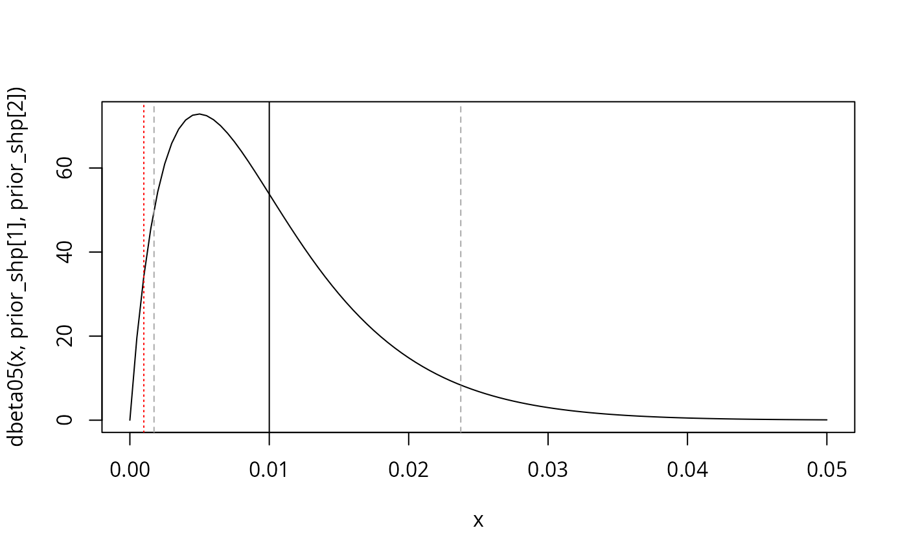

# Tutorial in use

``` r

library(wgsLR)
#> Loading required package: pracma
#> Loading required package: DEoptim
#> Loading required package: parallel
#> 
#> DEoptim package
#> Differential Evolution algorithm in R
#> Authors: D. Ardia, K. Mullen, B. Peterson and J. Ulrich
```

## Load data

Load in allele frequencies, columns `Chr`, `Position`, `Ref`, and `AF`
required::

``` r

d_AF <- data.frame(Chr = c("chr1", "chr1", "chr2", "chr2"), 
                   Position = c(111, 112, 221, 222), 
                   Ref = c("A", "G", "T", "T"),
                   AF = c(0.4, 0.3, 0.2, 0.25)) # AF for reference
d_AF
#>    Chr Position Ref   AF
#> 1 chr1      111   A 0.40
#> 2 chr1      112   G 0.30
#> 3 chr2      221   T 0.20
#> 4 chr2      222   T 0.25
```

Load in trace and reference samples.

For **trace**, columns `Chr`, `Position`, `cM`, `Ref`, and `GT`
required:

``` r

d_trace <- data.frame(Chr = c("chr1", "chr1", "chr2", "chr2"), 
                      Position = c(111, 112, 221, 222),  # dummy for tutorial only
                      cM = c(0.1, 0.11, 0.2, 0.21), # dummy for tutorial only
                      Ref = c("A", "G", "T", "T"),
                      GT = c("0/0", "1/1", "0/1", "0/0"))
d_trace
#>    Chr Position   cM Ref  GT
#> 1 chr1      111 0.10   A 0/0
#> 2 chr1      112 0.11   G 1/1
#> 3 chr2      221 0.20   T 0/1
#> 4 chr2      222 0.21   T 0/0
```

For **reference**, columns `Chr`, `Position`, and `GT` required (trace
has information about `cM` and `Ref`):

``` r

d_ref <- data.frame(Chr = c("chr1", "chr1", "chr2", "chr2"), 
                    Position = c(111, 112, 221, 222),  # dummy for tutorial only
                    GT = c("0/1", "1/1", "0/1", "0/0"))
d_ref
#>    Chr Position  GT
#> 1 chr1      111 0/1
#> 2 chr1      112 1/1
#> 3 chr2      221 0/1
#> 4 chr2      222 0/0
```

## Merge (join) data

Annotate trace sample with reference sample and `AF` info:

``` r

d_trace$GT012 <- GT_convert_to_012(d_trace$GT)
d_ref$GT012 <- GT_convert_to_012(d_ref$GT)
d_trace_AF <- merge(x = d_trace, 
                    y = d_AF, 
                    suffixes = c("_trace", "_AF"),
                    by = c("Chr", "Position"),
                    all = FALSE)
d_trace_AF
#>    Chr Position   cM Ref_trace  GT GT012 Ref_AF   AF
#> 1 chr1      111 0.10         A 0/0     0      A 0.40
#> 2 chr1      112 0.11         G 1/1     2      G 0.30
#> 3 chr2      221 0.20         T 0/1     1      T 0.20
#> 4 chr2      222 0.21         T 0/0     0      T 0.25
```

Be sure that the `Ref` is correct:

``` r

all(d_trace_AF$Ref_trace == d_trace_AF$Ref_AF)
#> [1] TRUE
```

Prepare case data:

``` r

d_trace_ref <- merge(x = d_trace_AF, 
                     y = d_ref, 
                     suffixes = c("", "_ref"),
                     by = c("Chr", "Position"),
                    all = FALSE)
d_trace_ref
#>    Chr Position   cM Ref_trace  GT GT012 Ref_AF   AF GT_ref GT012_ref
#> 1 chr1      111 0.10         A 0/0     0      A 0.40    0/1         1
#> 2 chr1      112 0.11         G 1/1     2      G 0.30    1/1         2
#> 3 chr2      221 0.20         T 0/1     1      T 0.20    0/1         1
#> 4 chr2      222 0.21         T 0/0     0      T 0.25    0/0         0
```

## Generate profile sets

Generate a number of profile sets from minimal `cM` requirement:

``` r

set.seed(1)
lst_profilesets_loose <- generate_profilesets(d = d_trace_ref, cM_thres = 0.00001, n = 4)
lst_profilesets_loose
#> [[1]]
#>         Chr Position   cM Ref_trace  GT GT012 Ref_AF   AF GT_ref GT012_ref
#> chr1.1 chr1      111 0.10         A 0/0     0      A 0.40    0/1         1
#> chr1.2 chr1      112 0.11         G 1/1     2      G 0.30    1/1         2
#> chr2.3 chr2      221 0.20         T 0/1     1      T 0.20    0/1         1
#> chr2.4 chr2      222 0.21         T 0/0     0      T 0.25    0/0         0
#> 
#> [[2]]
#>         Chr Position   cM Ref_trace  GT GT012 Ref_AF   AF GT_ref GT012_ref
#> chr1.1 chr1      111 0.10         A 0/0     0      A 0.40    0/1         1
#> chr1.2 chr1      112 0.11         G 1/1     2      G 0.30    1/1         2
#> chr2.3 chr2      221 0.20         T 0/1     1      T 0.20    0/1         1
#> chr2.4 chr2      222 0.21         T 0/0     0      T 0.25    0/0         0
#> 
#> [[3]]
#>         Chr Position   cM Ref_trace  GT GT012 Ref_AF   AF GT_ref GT012_ref
#> chr1.1 chr1      111 0.10         A 0/0     0      A 0.40    0/1         1
#> chr1.2 chr1      112 0.11         G 1/1     2      G 0.30    1/1         2
#> chr2.3 chr2      221 0.20         T 0/1     1      T 0.20    0/1         1
#> chr2.4 chr2      222 0.21         T 0/0     0      T 0.25    0/0         0
#> 
#> [[4]]
#>         Chr Position   cM Ref_trace  GT GT012 Ref_AF   AF GT_ref GT012_ref
#> chr1.1 chr1      111 0.10         A 0/0     0      A 0.40    0/1         1
#> chr1.2 chr1      112 0.11         G 1/1     2      G 0.30    1/1         2
#> chr2.3 chr2      221 0.20         T 0/1     1      T 0.20    0/1         1
#> chr2.4 chr2      222 0.21         T 0/0     0      T 0.25    0/0         0
rm(lst_profilesets_loose)  # not useds
lst_profilesets <- generate_profilesets(d = d_trace_ref, cM_thres = 1, n = 4)
lst_profilesets
#> [[1]]
#>       Chr Position   cM Ref_trace  GT GT012 Ref_AF   AF GT_ref GT012_ref
#> chr1 chr1      112 0.11         G 1/1     2      G 0.30    1/1         2
#> chr2 chr2      222 0.21         T 0/0     0      T 0.25    0/0         0
#> 
#> [[2]]
#>       Chr Position   cM Ref_trace  GT GT012 Ref_AF  AF GT_ref GT012_ref
#> chr1 chr1      112 0.11         G 1/1     2      G 0.3    1/1         2
#> chr2 chr2      221 0.20         T 0/1     1      T 0.2    0/1         1
#> 
#> [[3]]
#>       Chr Position  cM Ref_trace  GT GT012 Ref_AF  AF GT_ref GT012_ref
#> chr1 chr1      111 0.1         A 0/0     0      A 0.4    0/1         1
#> chr2 chr2      221 0.2         T 0/1     1      T 0.2    0/1         1
#> 
#> [[4]]
#>       Chr Position  cM Ref_trace  GT GT012 Ref_AF  AF GT_ref GT012_ref
#> chr1 chr1      111 0.1         A 0/0     0      A 0.4    0/1         1
#> chr2 chr2      221 0.2         T 0/1     1      T 0.2    0/1         1
```

Prepare genotype probabilities. Here, we assume Hardy-Weinberg
equilibrium and that the `AF` column is the `Ref` allele probability:

``` r

lst_GTprobs <- lapply(lst_profilesets, \(d) {
  lapply(d$AF, \(q) {
    c(q^2, 2*(1-q)*q, (1-q)^2)
  })
})
lst_GTprobs
#> [[1]]
#> [[1]][[1]]
#> [1] 0.09 0.42 0.49
#> 
#> [[1]][[2]]
#> [1] 0.0625 0.3750 0.5625
#> 
#> 
#> [[2]]
#> [[2]][[1]]
#> [1] 0.09 0.42 0.49
#> 
#> [[2]][[2]]
#> [1] 0.04 0.32 0.64
#> 
#> 
#> [[3]]
#> [[3]][[1]]
#> [1] 0.16 0.48 0.36
#> 
#> [[3]][[2]]
#> [1] 0.04 0.32 0.64
#> 
#> 
#> [[4]]
#> [[4]][[1]]
#> [1] 0.16 0.48 0.36
#> 
#> [[4]][[2]]
#> [1] 0.04 0.32 0.64
```

## Compute evidential weight

Compute the WoE’s.

### No errors possible

First with fixed error probabilities of 0:

``` r

LRs_w0 <- lapply(seq_along(lst_profilesets), \(i) {
  d_SNPs <- lst_profilesets[[i]]
  genotype_probs <- lst_GTprobs[[i]]
  calc_LRs_w(xT = d_SNPs$GT012, xR = d_SNPs$GT012_ref, w = 0, p = genotype_probs)
})
LRs_w0
#> [[1]]
#> [1]  2.040816 16.000000
#> 
#> [[2]]
#> [1] 2.040816 3.125000
#> 
#> [[3]]
#> [1] 0.000 3.125
#> 
#> [[4]]
#> [1] 0.000 3.125
WoE_w0 <- sapply(LRs_w0, \(lr) sum(log10(lr)))
WoE_w0
#> [1] 1.5139239 0.8046539      -Inf      -Inf
WoE_w0_avg <- mean(WoE_w0)
WoE_w0_avg
#> [1] -Inf
```

### Fixed, known error rates

Then with `wT = 1/100` and `wR = 1/1000`

``` r

LRs_wT0_01wR0_001 <- lapply(seq_along(lst_profilesets), \(i) {
  d_SNPs <- lst_profilesets[[i]]
  genotype_probs <- lst_GTprobs[[i]]
  calc_LRs_wTwR(xT = d_SNPs$GT012, xR = d_SNPs$GT012_ref, 
                wT = 1/100, wR = 1/1000,
                p = genotype_probs)
})
LRs_wT0_01wR0_001
#> [[1]]
#> [1]  2.021544 14.983453
#> 
#> [[2]]
#> [1] 2.021544 2.983944
#> 
#> [[3]]
#> [1] 0.06516771 2.98394368
#> 
#> [[4]]
#> [1] 0.06516771 2.98394368
WoE_wT0_01wR0_001 <- sapply(LRs_wT0_01wR0_001, \(lr) sum(log10(lr)))
WoE_wT0_01wR0_001
#> [1]  1.4812950  0.7804737 -0.7111769 -0.7111769
WoE_wT0_01wR0_001_avg <- mean(WoE_wT0_01wR0_001)
WoE_wT0_01wR0_001_avg
#> [1] 0.2098537
```

### Fixed reference sample error rates, integrate over trace sample error rate

And now `wR = 1/1000` and integrating over `wT` with this prior
distribution (red dotted is `wR`, grey dashed mark 5% and 95%
quantiles):

``` r

prior_mean <- 1/100
prior_var <- prior_mean^2/2
prior_shp <- wgsLR::get_beta_parameters(mu = prior_mean,
                                        sigmasq = prior_var,
                                        a = 0,
                                        b = 0.5)

curve(dbeta05(x, prior_shp[1], prior_shp[2]), from = 0, to = 0.05) 
abline(v = prior_mean)
abline(v = qbeta05(0.05, prior_shp[1], prior_shp[2]), lty = 2, col = "darkgrey")
abline(v = qbeta05(0.95, prior_shp[1], prior_shp[2]), lty = 2, col = "darkgrey")
abline(v = 1/1000, lty = 3, col = "red")
```



``` r


qbeta05(0.05, prior_shp[1], prior_shp[2])
#> [1] 0.001732418
qbeta05(0.95, prior_shp[1], prior_shp[2])
#> [1] 0.02373713
```

So that 90% central probability of the prior is between 0.0017 and
0.024.

Using the same prior under both hypotheses, we get:

``` r

WoE_int <- lapply(seq_along(lst_profilesets), \(i) {
  d_SNPs <- lst_profilesets[[i]]
  genotype_probs <- lst_GTprobs[[i]]
  
  calc_WoE_wTwR_integrate_wT_mc(
    xT = d_SNPs$GT012, xR = d_SNPs$GT012_ref, 
    wR = 1/1000, 
    shape1T_Hp = prior_shp[1], shape2T_Hp = prior_shp[2],
    shape1T_Ha = prior_shp[1], shape2T_Ha = prior_shp[2],
    p = genotype_probs, 
    n_samples = 1000)
}) |> unlist()
WoE_int
#> [1]  1.4819775  0.7803912 -0.7315334 -0.7276973
WoE_int_avg <- mean(WoE_int)
WoE_int_avg
#> [1] 0.2007845
```
